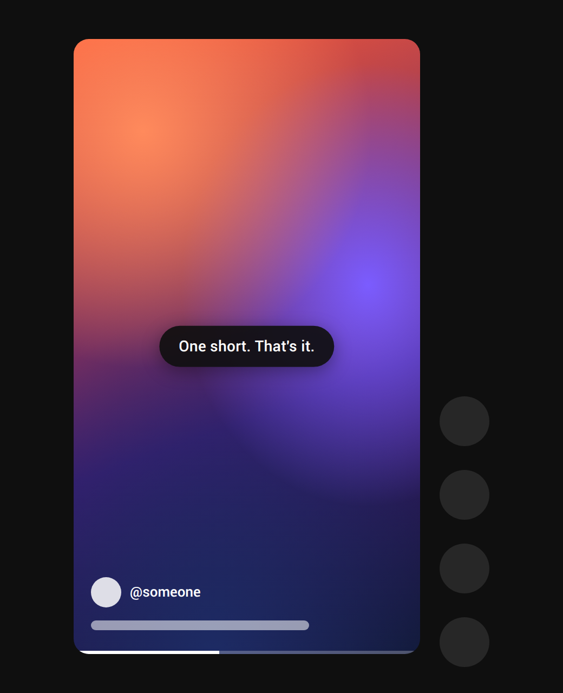
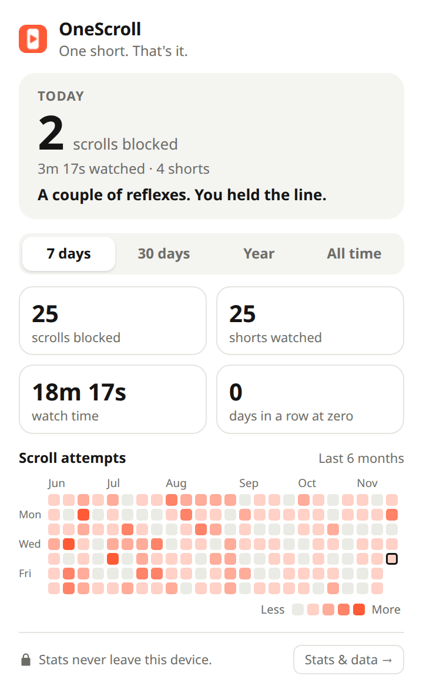
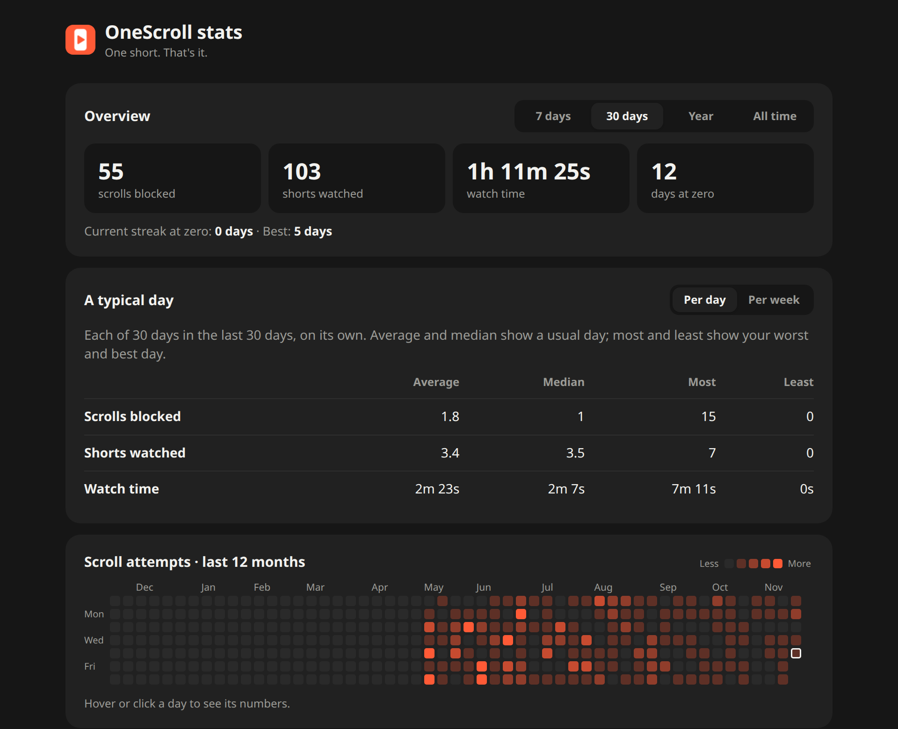

<p align="center">
  
</p>

<h1 align="center">OneScroll</h1>

<p align="center"><b>One short. That's it.</b></p>

<p align="center">
  A browser extension for Firefox and Chromium that takes the endless scroll out of YouTube Shorts.<br>
  Open a Short, watch it — there is no “next one”.
</p>

<p align="center">
  
  &nbsp;&nbsp;
  <picture>
    <source media="(prefers-color-scheme: dark)" srcset="docs/popup-dark.png">
    
  </picture>
</p>

## What it does

- **No scrolling between Shorts.** Mouse wheel, swipe, ↑/↓, PageUp/PageDown and the up/down buttons are all blocked on `/shorts/`. Comments and descriptions still scroll normally.
- **Nothing to peek at.** The edges of the next and previous Shorts are hidden.
- **A gentle nudge.** Try to scroll and a small *“One short. That's it.”* appears over the video.
- **Stats, if you're curious.** Blocked attempts, shorts watched and watch time — per day, week, month, year — with streaks and a GitHub-style heatmap.

<p align="center">
  
</p>

## Private by design

- Stats live only in your browser (`storage.local`). Nothing is sent anywhere — no servers, no analytics.
- Only daily numbers are kept. No video IDs, titles or history.
- Export, import (merge or replace) and reset are on the **Stats & data** page.
- The only permission is `storage`; the extension runs only on `youtube.com`.

## Install

Store listings are on the way. Until then, load it from source:

- **Firefox:** open `about:debugging#/runtime/this-firefox` → *Load Temporary Add-on…* → pick `manifest.json`.
- **Chrome / Edge / Brave:** open `chrome://extensions` → enable *Developer mode* → *Load unpacked* → pick this folder.

## Development

```bash
npm install
npm run start:firefox        # Firefox with the extension, reloads on save
npm run start:chromium
npm run start:firefox:debug  # same, with the browser console in the terminal
npm run lint
npm run build                # zip for the stores, in web-ext-artifacts/
```

Want to see the stats with data in them? Import `dev/demo-stats.json` on the Stats & data page
(export your own first and choose *Replace* — then import yours back).

---

<p align="center">
  made by anton pova · <a href="LICENSE">MIT</a><br>
  <sub>Not affiliated with YouTube or Google.</sub>
</p>
